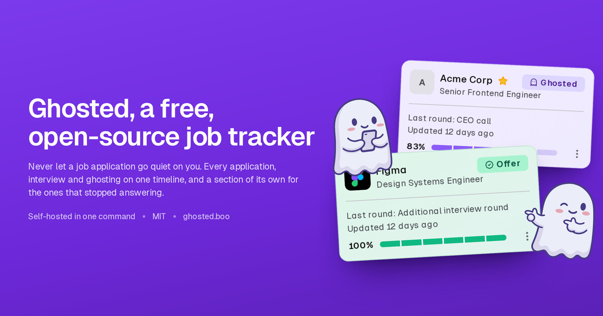
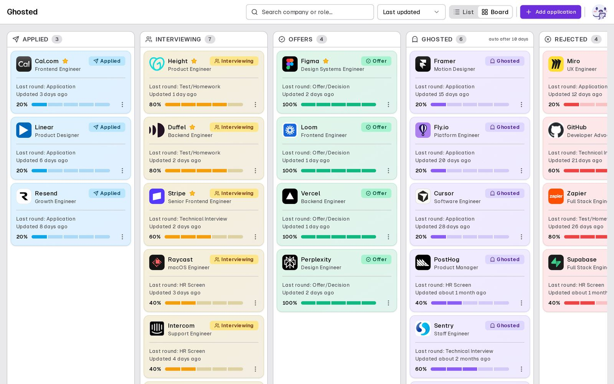

# Ghosted — A Free, FOSS Job Tracker

[](LICENSE)
[](CONTRIBUTING.md)
[](https://nextjs.org)
[](https://github.com/nomorenamesstudio/ghosted/actions/workflows/ci.yml)



**A free, open-source job tracker that keeps every application and interview on
one timeline — and gives the ones that went quiet a section of their own.**

Hosted at **[ghosted.boo](https://ghosted.boo)**. Self-host it with Docker and
your own Postgres, or use the hosted instance. No paid tier, no ads, no AI
reading your mail.

## Why this exists

Every job tracker I tried was a spreadsheet, an inbox, or somebody's subscription
funnel. Ghosting and hundreds of applications are the baseline of looking for
work now, and the applications that go silent are exactly the ones you forget
first: no rejection, no reply, nothing.

A friend applied to more than 500 places before me and had nothing encouraging to
report. I started my own hunt in late August 2026, logged the first real
application on 3 September, and it ghosted me too. So the quiet ones got their own
section, and a stalled hunt became something I could see.

## What it does

| | |
| --- | --- |
| **A board and a list** | The same applications two ways. Drag cards between stages, or read them as sections that scroll. |
| **Ghosted, automatically** | An application that has not moved for ten days leaves its stage and joins the ghosted ones. You set the pace. |
| **One timeline per application** | Five rounds by default, extendable and reorderable. Finishing a round advances the status; rejected, archived and offer stay in your hands. |
| **Everything exported** | JSON export any time, import into an existing account, and account deletion that actually deletes. |
| **Search, filter, favorites** | Find by company or role, filter by status, pin the ones you care about, and undo an archive. |
| **Night mode, keyboard, screen reader** | System theme or manual, usable without a mouse, readable at 200% zoom. The end-to-end suite runs axe on every page. |
| **Your own instance** | One container and a Postgres. Two environment flags decide whether it is a solo instance or a family one. |



## Quick start

```bash
git clone https://github.com/nomorenamesstudio/ghosted && cd ghosted
cp .env.example .env      # set AUTH_SECRET: openssl rand -base64 32
docker compose up -d      # Postgres
pnpm install && pnpm db:migrate && pnpm db:seed
pnpm dev                  # http://localhost:3000 — demo@example.com / password123
```

Self-hosting is the same image with different flags:

```bash
docker compose --profile selfhost up -d
```

Migrations run at container start under an advisory lock, and a failed migration
exits the container instead of serving a half-migrated database. Full walkthrough,
environment reference, email options, backups and upgrades:
[docs/SELFHOST.md](docs/SELFHOST.md).

## How it works

```
        ┌───────────────────────────────────────┐
 you ──►│  Next.js 15 app  (board · list · one  │
        │  timeline per application)            │
        └──────────────────┬────────────────────┘
                           │  Drizzle ORM
                 ┌─────────▼──────────┐
                 │     PostgreSQL     │
                 │  applications      │
                 │  milestones        │
                 │  users, sessions   │
                 └────────────────────┘

 status  =  derived from milestones + your patience window
 ghosted =  no movement for 10 days (per-account setting)
```

One Postgres holds everything. Self-hosted, that database is yours; on the hosted
instance it is mine, and it leaves with you as JSON.

## Built with AI

Ghosted is hand-written and AI-enhanced. The architecture, design and product
decisions are mine; the AI wrote and refactored much of the code, and every change
was read, tested and committed by hand. Mostly DeepSeek V4 and V4.1 Flash in
DeepSeek Harness, with GLM-5.3 running the security passes. Code a machine wrote is
still code a human is accountable for.

## FAQ

### Is Ghosted really free?

Yes. No paid tier, no ads, nothing about your hunt is sold. Job hunting already
costs money and time, so charging rent on the logbook never made sense.

### Why is there no AI in Ghosted?

The product writes nothing for you, applies to nothing for you and reads no
mailbox. It knows only what you type into it. There is no model, no API key and no
token bill at runtime.

### Can I self-host it?

Yes. One container plus a Postgres, everything else in environment variables. No
prebuilt image ships on purpose: the app bakes your domain into its pages at build
time, so you build it yourself with Docker Compose.

### How does it decide an application went quiet?

Ten days without movement, by default, and you set your own pace per account. It is
a nudge rather than a verdict — anything you have touched recently stays put.

### Who built it?

K, at [No More Names Studio](https://nomorenames.studio). Ghosted started during my
own hunt in 2026 and grew out of whatever was missing while I logged applications.

### What's the catch?

There is none. No funding, no scaling, no exit strategy, no data harvesting. The
logbook stays the size of a logbook on purpose.

## Contributing

1. Read [CONTRIBUTING.md](CONTRIBUTING.md) — it covers local setup, the test suites
   and what gets merged.
2. Open an issue for what breaks, or a pull request for what you would rather fix.
3. Self-host it and report how it went on your machine. That report is the most
   useful thing you can send.

Ghosted is simple on purpose: a pull request is merged when it respects the scope of
the project, and a model-drafted one is welcome as long as you read it first.

## Documentation

[Setup](docs/SETUP.md) · [Self-hosting](docs/SELFHOST.md) ·
[API](docs/API.md) · [Architecture](docs/ARCHITECTURE.md) ·
[Changelog](docs/CHANGELOG.md) · [The story](docs/STORY.md) ·
[Costs](docs/COSTS.md) · [Releasing](docs/RELEASING.md) ·
[Reviews](docs/reviews/) · [Security](SECURITY.md) · [Docs index](docs/INDEX.md)

## License

MIT — see [LICENSE](LICENSE). Use it, fork it, self-host it.

[](https://github.com/nomorenamesstudio/ghosted)

Built by [K](https://github.com/nomorenamesstudio) |
[nomorenames.studio](https://nomorenames.studio)
