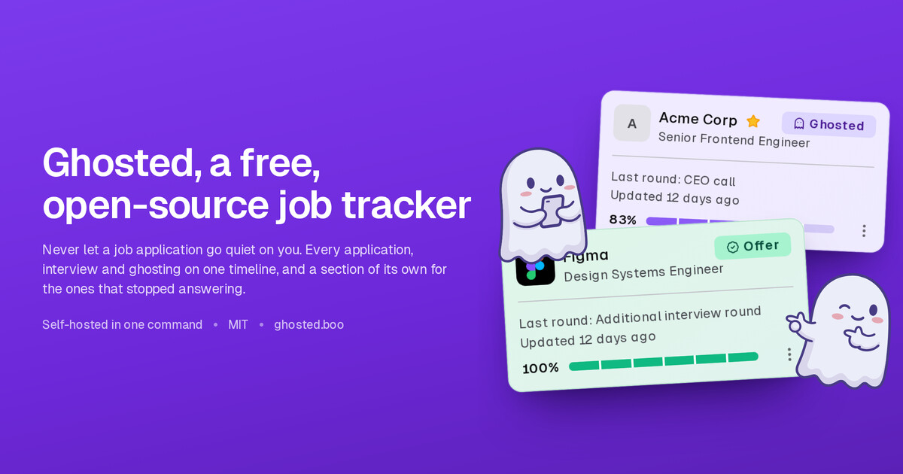

# Ghosted — A Free, FOSS Job Tracker

[](LICENSE)
[](CONTRIBUTING.md)
[](https://nextjs.org)
[](https://github.com/nomorenamesstudio/ghosted/actions/workflows/ci.yml)



**A free, open-source job tracker that keeps every application and interview on
one timeline — and gives the ones that went quiet a section of their own.**

Hosted at **[ghosted.boo](https://ghosted.boo)**. Self-host it with Docker and
your own Postgres, or use the hosted instance. No paid tier, no ads, no AI
reading your mail.

## Why this exists

Every job tracker I tried was a spreadsheet, an inbox or somebody's subscription
funnel. Ghosting and hundreds of applications are the baseline of looking for work
now, and the applications that go silent are exactly the ones you forget first: no
rejection, no reply, nothing.

A friend applied to more than 500 places before me and had nothing encouraging to
report. I started my own hunt in late August 2026, logged the first real application
on 3 September, and it ghosted me too. So the quiet ones got their own section, and a
stalled hunt became something I could see.

## What it does

- **A board and a list.** The same applications two ways: drag cards between stages,
  or read them as sections that scroll.
- **Ghosted, automatically.** An application that hasn't moved for ten days leaves its
  stage and joins the ghosted ones. Ten is the default; you set your own pace.
- **One timeline per application.** Five rounds to start with, which you can rename,
  extend and reorder. Finishing a round moves the status along; rejected, archived and
  offer stay your call.
- **Your data, yours to take.** Export everything as JSON any time, import it into
  another account, and when you delete your account, it's actually gone.
- **Search, filter, favorites.** Find by company or role, filter by status, pin the
  ones you care about, and undo an archive.
- **Light, dark, keyboard, screen reader.** It follows your device or you pin a
  theme. It works without a mouse and reads fine at 200% zoom.
- **Works with your agent, if you want.** Connect your own AI agent and it can log
  applications for you — you pick exactly what it's allowed to touch.
  [How that works](docs/MCP.md).


### One application, opened


The board is the overview. This is what it keeps — everything a spreadsheet would
lose.

- **The timeline is the process itself.** One row per round, in order, dated where it
  actually happened. This one was read off the posting: five rounds, each with its
  length in the step's comment, instead of the defaults every application starts with.
- **The open step is the editor.** Title, status (pending, done, skipped), date and a
  comment. **Save & mark done** stamps the date and moves the status along for you
  (applied → interviewing → offer), so the board is never a separate thing to update.
- **The card on the right is the job.** The posting, the employer's own site (that's
  where the logo comes from), a contact, and notes — here, the salary band.
- **Add milestone** handles a process that keeps growing.

## Run your own

Ghosted is one container and a Postgres. Two settings decide whether it's just you or
a few people (a family, a friend group):

```bash
git clone https://github.com/nomorenamesstudio/ghosted && cd ghosted
cp .env.example .env        # set AUTH_SECRET (openssl rand -base64 32), AUTH_URL and NEXT_PUBLIC_APP_URL
docker compose --profile selfhost up -d
```

There's no prebuilt image on purpose: the app bakes your domain into its pages when
it's built, so you build it yourself. Database migrations run when the container
starts, and a failed one stops the container instead of serving a half-migrated
database. The full walkthrough — environment, email, backups, upgrades — is in
[docs/SELFHOST.md](docs/SELFHOST.md).

## FAQ

### Is Ghosted really free?

Yes. No paid tier, no ads, and nothing about your hunt is sold. Job hunting already
costs money and time, so charging rent on the logbook never made sense. If you feel
like it you can [buy me a coffee](https://www.buymeacoffee.com/nomorenames), and skipping
it changes nothing.

### Why is there no AI in Ghosted?

Ghosted ships no model, no API key and no token bill: it writes nothing for you,
applies to nothing for you and reads no mailbox. It knows only what you type into it —
or what an agent you chose to connect asks it to store, within the scope you gave it.

### Can my own agent use Ghosted?

Yes, over MCP. You pick what it can reach — read only, read and edit, or full access
with the destructive tools — and no scope can touch your email, password or account
deletion. [How to connect one](docs/MCP.md).

### How does Ghosted decide an application went quiet?

Ten days without movement, by default, and you set your own pace per account. It's a
nudge, not a verdict: anything you've touched recently stays where it is.

### Can I self-host Ghosted?

Yes. One container and a Postgres, migrations on start, everything else in
environment variables. No prebuilt image ships on purpose — the app bakes your domain
into its pages at build time — so you build it yourself with Docker Compose, or use
the hosted instance at [ghosted.boo](https://ghosted.boo).

### Can I take my data with me?

Yes. Every application, milestone and note exports as JSON whenever you like. A
tracker you can't leave isn't one you can trust.

### Who built Ghosted?

K, at [No More Names Studio](https://nomorenames.studio). It started during my own hunt
in 2026 and grew out of whatever was missing while I logged applications. It's built
through human-in-the-loop agentic development, steered by decades of design and code:
the design, the product and the architecture are mine.

### What's the catch?

There isn't one. No funding, no scaling, no exit strategy, no data harvesting. It's a
logbook for your hunt and it stays that size on purpose. If you'd rather trust nobody's
server, run your own — that's the whole business model.

## Contributing

Bug reports, fixes and self-hosting reports are all welcome — a note on how it went on
your machine is the most useful thing you can send. [CONTRIBUTING.md](CONTRIBUTING.md)
covers local setup, the test suites and what gets merged. Ghosted is small on purpose,
so a pull request lands when it fits that scope.

To hack on it locally:

```bash
cp .env.example .env        # set AUTH_SECRET
docker compose up -d        # Postgres
pnpm install && pnpm db:migrate && pnpm db:seed
pnpm dev                    # http://localhost:3000 — demo@example.com / password123
```

## Documentation

[Self-hosting](docs/SELFHOST.md) · [Using an agent](docs/MCP.md) ·
[Setup](docs/SETUP.md) · [Architecture](docs/ARCHITECTURE.md) · [API](docs/API.md) ·
[Changelog](docs/CHANGELOG.md) · [The story](docs/STORY.md) · [Security](SECURITY.md) ·
[All docs](docs/INDEX.md)

## License

MIT — see [LICENSE](LICENSE). Use it, fork it, run your own.

Made with ♥ by [No More Names Studio](https://nomorenames.studio)
